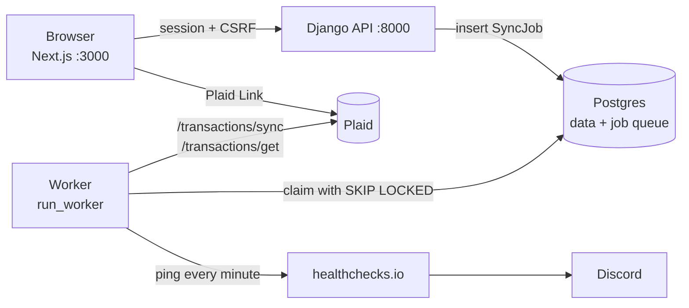

# Personal Finance Tracker

A personal finance app I use for my own money. It links bank accounts through Plaid, pulls transactions in the background, and shows where the money went: net spending by category, monthly targets, search and filters, CSV export.

The dashboard is the visible part. Most of the work is in the sync pipeline behind it. Bank syncs fail in ordinary ways (rate limits, bank outages, a worker killed halfway through a job), so the pipeline is built so that any job can be retried or re-run without losing or duplicating data. I tested that by killing and freezing workers on purpose; the results are [below](#fault-injection).

## Stack

- **Frontend:** Next.js 15, React 18, MUI, Recharts (`frontend/web`)
- **API:** Django 5.1 and Django REST Framework, session auth with CSRF (`backend`)
- **Worker:** a Django management command running in its own container, using the same image as the API
- **Database:** PostgreSQL 18, which is also the job queue
- **Bank data:** Plaid Transactions (`/transactions/sync` for syncing, `/transactions/get` for reconciliation)
- **Alerting:** healthchecks.io dead-man's switch, posting to Discord
- Everything runs in Docker Compose.

## How it works



### Linking a bank

1. The browser asks the API for a Plaid link token and opens Plaid Link.
2. When the user finishes, Plaid hands the browser a public token and the bank's name. The browser sends both to `POST /api/exchange_public_token/`.
3. The API exchanges the public token for an access token, stores a `PlaidItem` (one per bank login), queues a sync job, and returns `202` right away. The access token stays on the server and is never sent to the browser.
4. The dashboard polls `GET /api/sync_status/` and shows the transactions once the worker has finished the first sync.

### The job queue

There is no Celery or Redis. The `SyncJob` table is the queue, so a job's row is the only record of its state.

- The worker claims the oldest runnable job with `SELECT ... FOR UPDATE SKIP LOCKED`, so two workers never take the same job.
- A partial unique index allows at most one active (queued or in-progress) job per Item. Two syncs of the same bank can't race on its cursor, and a sync requested while one is running joins the running one.
- Every job is either a `sync` or a `reconcile`. Each try at a job gets its own `SyncAttempt` row with its timing, step, and error.

### A sync, step by step

1. Claim the job and take a 60-second lease on it.
2. Fetch a page from `/transactions/sync`, renewing the lease first.
3. Upsert the page with `INSERT ... ON CONFLICT DO UPDATE`, keyed on Plaid's `transaction_id`. Replaying a page changes nothing.
4. Repeat until Plaid says there are no more pages.
5. Save the new cursor, only now, after every page has been written. If anything fails earlier, the next attempt starts from the old cursor and replays the pages, which the upsert absorbs. Plaid requires exactly this restart behavior after a `TRANSACTIONS_SYNC_MUTATION_DURING_PAGINATION` error.

Failures are retried only if they're on an allowlist of transient errors (rate limits, institution down, network timeouts). Retries back off exponentially from 15 seconds with ±20% jitter, up to 7 attempts. Anything else, like an expired bank login or a bug in my code, fails on the first try so it shows up right away.

### Scheduling, reconciliation, and health

- The worker checks once a minute and queues a sync for any Item that hasn't had one in 6 hours.
- Once a day per Item it queues a reconcile. This pulls the last 30 days from `/transactions/get`, a different Plaid endpoint than the sync path uses, and diffs it against the database. Missing, extra, and changed transactions are repaired automatically, and each repair is written to an audit table with before and after snapshots.
- `GET /api/sync_status/` reports each Item as healthy (a successful sync in the last 12 hours), `stale`, `never_synced`, or `job_stuck`, along with the current job and the last error. The dashboard shows this per bank.
- The worker pings healthchecks.io once a minute from its main loop. If the pings stop because the worker crashed, hung, or the machine went down, healthchecks.io posts to Discord. An alert sent by the worker itself couldn't report the worker's own death.
- Logs are logfmt (`key=value`). Every line from a job carries `job_id`, `attempt`, `item_id`, and `kind`, so one grep shows a job's whole history across retries. Fields with `token`, `secret`, or `password` in the name are redacted.

### Money

Amounts are stored exactly as Plaid sends them: positive is money out, negative is refunds, payments, and income. Interpreting them is left to the display layer. Spending totals are net: a refund lowers its own category, and transfers, loan payments, and income are left out so card payments aren't counted twice.

When I recategorize a transaction, it's flagged as a user override, and later syncs and reconciles leave that category alone. Other fields still follow Plaid.

## Fault injection

I ran four exercises against Plaid Sandbox with the stack running locally. To have a predictable moment to break things, the worker can be told to sleep 30 seconds between page 1 and page 2 of a sync, after page 1 is written and before the cursor is saved. The full write-up with timestamps is in [FaultInjection.md](FaultInjection.md).

| Exercise | What happened |
|---|---|
| Kill the worker mid-sync, before any fix | The job stayed `in_progress` forever. Restarting the worker didn't help, because it only claimed `queued` jobs, and the one-active-job rule then rejected every future sync for that bank. The only trace was a DEBUG log line. The job sat stuck for about 31 hours, until the fix below. |
| First start after the fix | Both jobs that had been abandoned were reclaimed as second attempts and completed. The blocked bank got its scheduled sync and reconcile, and the reconcile found no drift. 962 transactions, 962 distinct IDs: the replayed page caused no duplicates. |
| Two workers on one queue | Five jobs were split between the workers (3 and 2), and every job ID showed up under exactly one worker. |
| Freeze a worker mid-sync with `docker pause`, then wake it | About a second after the lease ran out, the other worker took the job over, finished it, and saved the cursor. When the frozen worker woke up, it tried to renew its lease, saw that it no longer owned the job, and stopped without writing anything. Still 962 transactions, 962 distinct IDs. |
| Dead-man's switch | Discord got a "DOWN" alert about 3 minutes after the last ping (1 minute period plus 2 minutes grace), and "UP" after the restart. |

**The fix** is leases with a fencing token. Claiming a job sets `lease_expires_at` 60 seconds out, and the worker renews it before each page. Once the lease runs out, an `in_progress` job can be claimed again as a new attempt; after 7 abandoned attempts it fails instead of looping. The attempt number is the fencing token: renewing a lease is one conditional `UPDATE ... WHERE attempt_number = ?`, and if it matches no rows, the worker has lost the job and stops. Saving the cursor, writing repairs, and recording the outcome all happen inside a transaction that begins with that renewal, so a reclaim can't slip in between the check and the write.

The freeze test is the one that matters. A paused process isn't dead; it wakes up later still believing it owns the job. Leases alone would let it come back and overwrite the cursor the new owner just saved. Fencing is what stops it.

What the exercises showed, and what's still open:

- **One alert can't watch several workers.** During the freeze test, healthchecks.io stayed green because the other worker kept pinging the same check. With more than one worker, each would need its own check. I normally run one.
- **Leases trust each worker's clock.** One job's completion was stamped 0.43 seconds before its start, probably WSL2 correcting its clock after sleep. A clock jumping forward could make a worker reclaim a job that's still alive. Using the database's clock (`now()` in SQL) for both setting and checking leases would remove that.
- **Writes between renewals aren't fenced individually.** A worker that wakes up mid-page can still upsert that page before its next renewal. That's harmless here because the upsert is idempotent and the data is Plaid's, but only cursor saves, repairs, and outcomes are strictly fenced.
- **One renewal per page assumes a page takes well under 60 seconds.** If a Plaid call hangs past the lease, another worker takes the job and the original is fenced out when it returns.

## Design decisions

[Decisions.md](Decisions.md) has 31 numbered entries. Each one gives the options I considered, what I picked, and the tradeoff I accepted, all sized to the real load: one user, 4 bank logins, a handful of syncs a day. A few that shaped the rest:

- **004, 007:** the table is the queue and the worker is a hand-written loop, rather than Celery or a queue library, so there's one source of truth for job state.
- **010:** retry only errors known to be transient; unknown errors fail loudly.
- **016:** save the cursor only after the last page, so every retry restarts from the right place without special-case code.
- **018, 019:** reconcile against a different Plaid endpoint than the one sync uses, so the check doesn't share sync's blind spots.
- **030:** leases plus fencing instead of a reaper. A reaper can only judge by start time, so it can't tell a slow job from a dead one.

## Running it locally

You'll need Docker and a Plaid account with Sandbox keys.

1. Create a `.env` file next to `docker-compose.yml`:

   ```
   DJANGO_SECRET_KEY=<a long random string>
   POSTGRES_USER=finance
   POSTGRES_PASSWORD=<anything>
   POSTGRES_DB=finance
   PLAID_CLIENT_ID=<from the Plaid dashboard>
   PLAID_SECRET_SANDBOX=<from the Plaid dashboard>
   PLAID_ENV=sandbox
   PLAID_PRODUCTS=transactions
   PLAID_COUNTRY_CODES=US
   # Optional: healthchecks.io ping URL for the dead-man's switch
   HEALTHCHECK_PING_URL=
   ```

   `python -c "import secrets; print(secrets.token_urlsafe(50))"` makes a good secret key.

2. Start everything, create the tables, then start again so the worker (which exits if the tables aren't there yet) comes back up:

   ```bash
   docker compose up -d --build
   docker compose exec backend python manage.py migrate
   docker compose up -d
   ```

3. Open http://localhost:3000, register, and link a bank. In Sandbox, any bank works with username `user_good` and password `pass_good`.

`docker compose logs -f worker` shows the sync running. `make up` builds and starts the web app with its dependencies, but not the worker.

### Tests

```bash
docker compose exec backend pytest     # backend: needs the db container
cd frontend/web && npm test            # frontend: Vitest
```

The backend tests cover the queue, retries, leases and fencing, idempotent sync, reconciliation, the status rules, logging, monthly targets, and the API's ownership and auth checks. The frontend tests cover the spending math, date ranges, filters, edit validation, and CSV export.

## Repo layout

```
backend/
  app/jobs.py          queue: enqueue, claim, leases, retries, backoff
  app/views.py         sync_item (the page loop) and the API endpoints
  app/reconcile.py     /transactions/get diff and repair
  app/status.py        per-Item health for /api/sync_status/
  app/db_methods.py    upserts and the category-override rule
  app/heartbeat.py     dead-man's switch ping
  app/logging_utils.py logfmt formatter and job context
  app/management/commands/run_worker.py   the worker loop
frontend/web/
  src/app/             pages: login, register, link, dashboard
  src/components/      transaction list, sync status, monthly targets
  src/hooks/           sync status polling
  src/lib/             spending math, dates, filters, CSV (with tests)
Decisions.md           architecture decisions
FaultInjection.md      fault-injection write-up
```

## Limitations

- Built for one user at small scale. Polling a table works fine here and wouldn't at high throughput.
- Plaid access tokens are stored in plaintext in Postgres.
- Plaid sends a transaction again whenever it modifies it, and that overwrites manual edits to its name and amount. Category overrides are the only edits that survive.
- `get_item` and `get_liabilities` return `501`.
- `frontend/mobile` is an early placeholder and isn't used.
